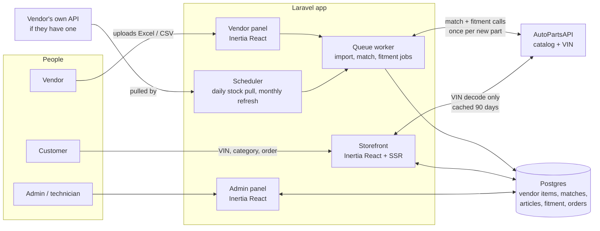
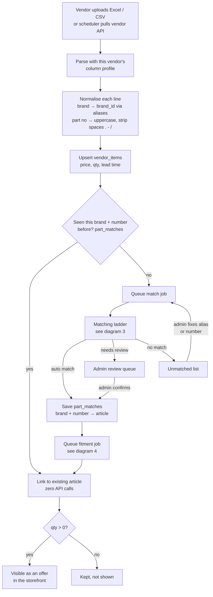
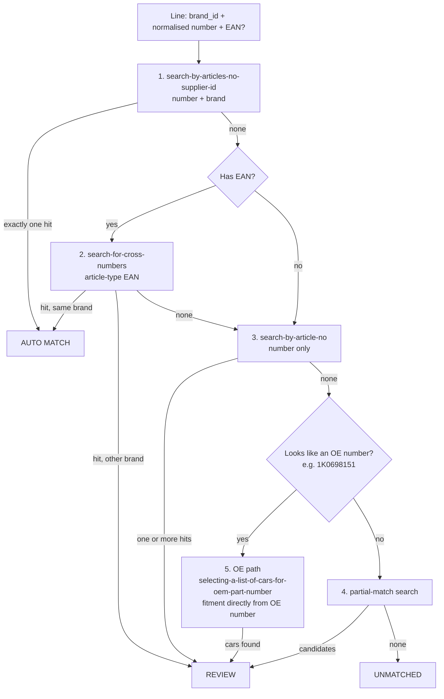
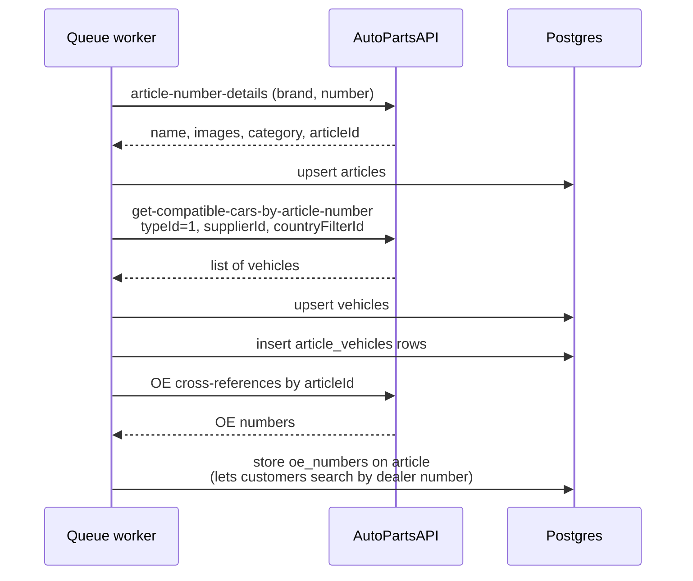
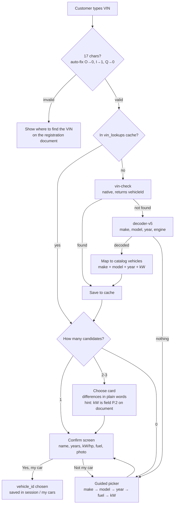
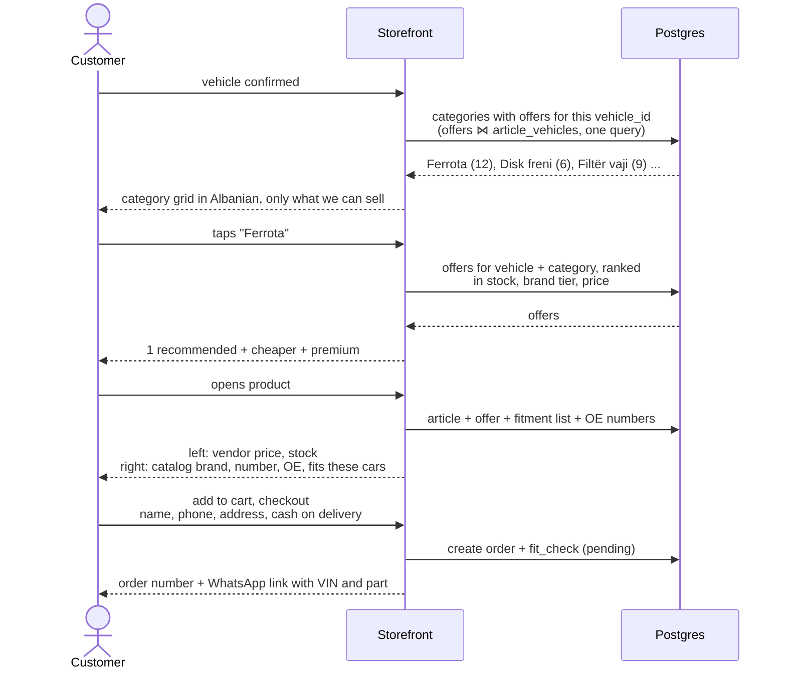
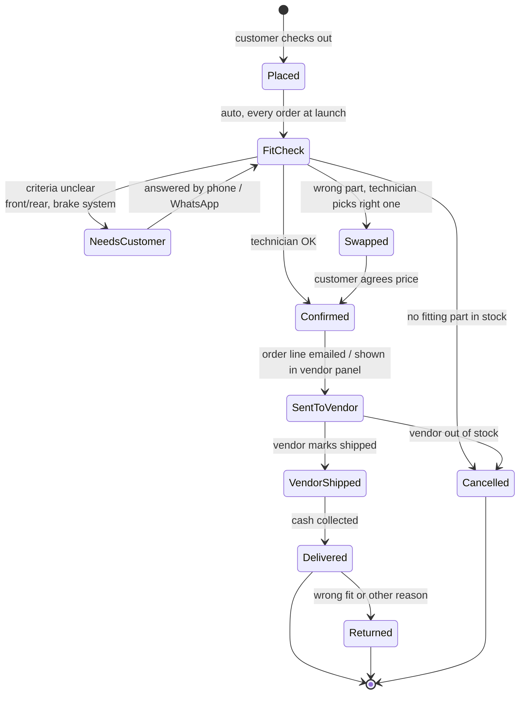
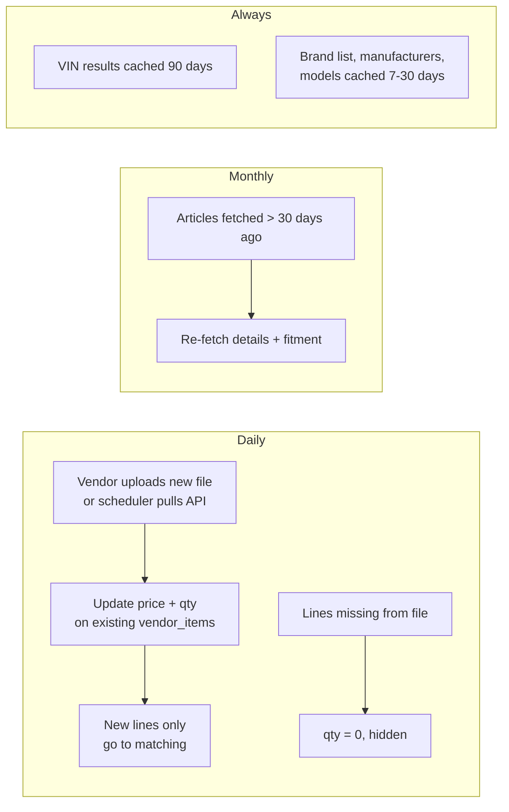
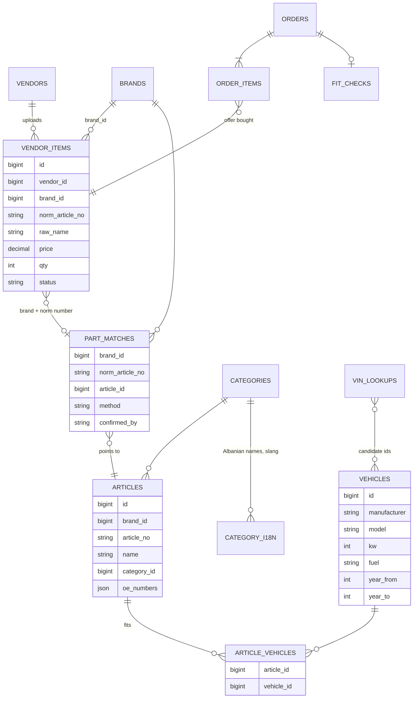

# 09 — Core flows (diagrams)

How the core feature works end to end: a vendor uploads a file, the system links each line to
the catalog, and a customer finds a part that fits by VIN. GitHub renders these Mermaid
diagrams as pictures.

Stack assumed: one Laravel app on Postgres. Storefront and the admin and vendor panels are
all Inertia React (storefront with SSR). No Filament. Background work runs on Laravel's database queue and scheduler.

## 1. The whole system on one page

The key idea: the catalog API is called **when parts arrive**, not when customers search. The
only live call during a search is the VIN decode, and that is cached.

## 2. Vendor upload to sellable offer

`part_matches` is shared across vendors. When vendor 2 uploads a part vendor 1 already had,
it links instantly.

## 3. The matching ladder (one vendor line)

Only step 1, and step 2 when the brand agrees, are trusted automatically. Everything else
waits for a human click in the admin panel.

## 4. Fitment job (once per newly matched article)

Cost is about 3 calls per new article, paid once. A monthly scheduler job refreshes
articles older than 30 days.

## 5. Customer: VIN to vehicle

## 6. Customer: vehicle to order

No catalog API calls happen anywhere in this diagram.

## 7. Order lifecycle with the technician check

Every question the technician asks in `NeedsCustomer` is logged. That log becomes the
automatic question table in phase 2.

## 8. Keeping data fresh

## 9. Core tables

`offers` is not a table. It is a query: vendor items that are matched and have qty above 0.
